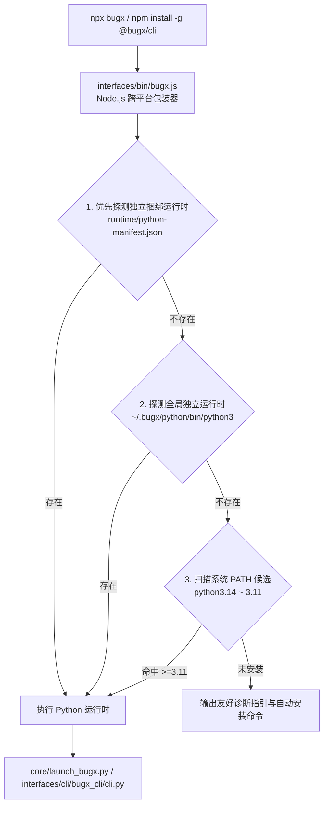

# BugX Interfaces: Executable Binary Wrappers (可执行二进制封装)

`interfaces/bin/` 包含了 BugX 面向 npm / npx / 全局命令行安装的跨平台可执行二进制脚本包装器。

---

## 1. 架构拓扑与自愈运行流 (Wrapper Execution Flow)

---

## 2. 模块文件物理索引与职责清单 (File Inventory)

| 文件名 | 职责与功能定位 | 运行机制与契约 |
| :--- | :--- | :--- |
| `bugx.js` | npm / 全局 CLI 跨平台包装脚本 | 自动探测并解析 Python 3.11+ 解释器（支持 Bundled / Global Standalone / System PATH），无损透传所有命令行参数与退出状态码 |

---

## 3. 设计契约与公理

- **零侵入与零环境要求**：Node 用户无需手动配置 Python 环境，包装器自动完成运行时发现与自愈引导。
- **状态码透明转发**：底层 Python 进程的退出状态码（Exit Code）必须原样返回给操作系统，保证在 CI/CD 流水线中的判定准确。
