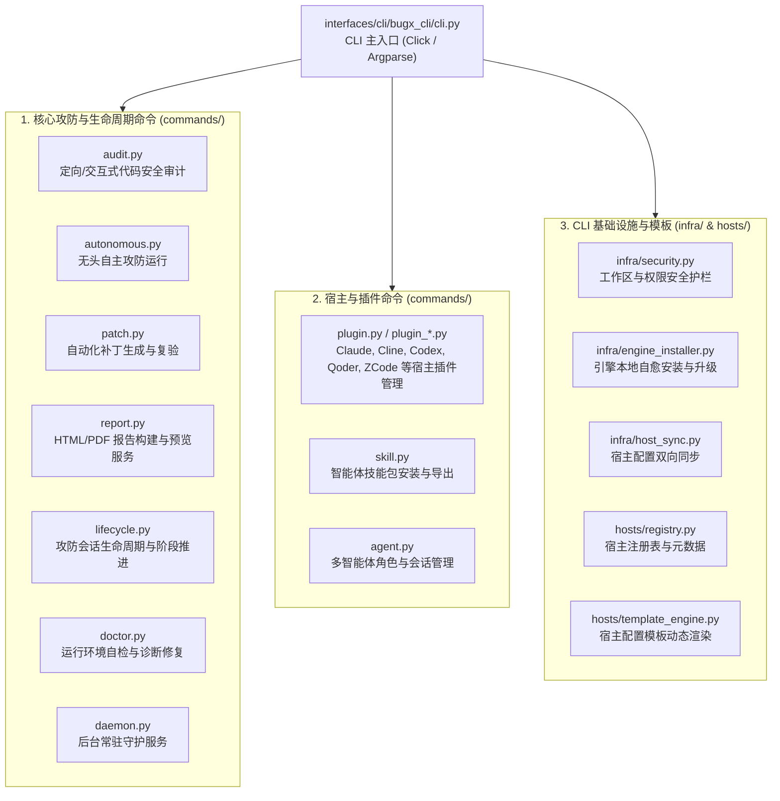

# BugX CLI (统一命令行界面与分发框架)

`interfaces/cli/` 是 BugX 的命令行交互与执行总入口。它承载了 24 个子命令模块、5 大基础设施支持模块、多宿主模板引擎与统一命令路由。

---

## 1. 架构拓扑与命令分发树 (CLI Command Tree)

---

## 2. 模块文件物理索引与职责清单 (File Inventory)

| 相对路径 / 文件名 | 职责与功能定位 | 关联子命令 / 核心能力 |
| :--- | :--- | :--- |
| `bugx_cli/` | CLI 核心包物理目录 | CLI Python 包主体 |
| `bugx_cli/cli.py` | CLI 命令行根入口，处理全局参数（`--root`, `--verbose`, `--json`）并分发子命令 | `bugx` CLI 调度入口 |
| `bugx_cli/common.py` | CLI 终端高亮着色、表格格式化、确认交互与退出码处理 | `print_banner`, `confirm_action` |
| `bugx_cli/host_adapters.py` | 宿主适配器命令行转接层，负责各宿主配置与命令映射 | `HostAdapterRegistry` |
| `bugx_cli/commands/advisory.py` | 安全漏洞情报查询命令（CVE/GHSA 数据库快速检索） | `bugx advisory` |
| `bugx_cli/commands/agent.py` | 攻防智能体协同状态查询与手动介入命令 | `bugx agent` |
| `bugx_cli/commands/audit.py` | 核心攻防审计执行命令，支持指定规则包与目标范围 | `bugx audit` |
| `bugx_cli/commands/autonomous.py` | 全自动无头攻防命令，一键启动无人值守自愈审计 | `bugx autonomous` |
| `bugx_cli/commands/cloud.py` | 云端飞轮知识同步与隐私授权配置命令 | `bugx cloud` |
| `bugx_cli/commands/daemon.py` | BugX 后台驻留守护进程与任务调度管理命令 | `bugx daemon` |
| `bugx_cli/commands/doctor.py` | 系统与环境全方位健康诊断自愈命令 | `bugx doctor` |
| `bugx_cli/commands/goal.py` | 长期目标驱动的迭代攻防探索命令 | `bugx goal` |
| `bugx_cli/commands/knowledge.py` | 历史错题经验与防御知识库检索命令 | `bugx knowledge` |
| `bugx_cli/commands/lifecycle.py` | 审计生命周期阶段查询与控制命令 | `bugx lifecycle` |
| `bugx_cli/commands/matrix.py` | 多维度攻防矩阵与多环境测试命令 | `bugx matrix` |
| `bugx_cli/commands/patch.py` | 代码修复补丁验证与应用命令 | `bugx patch` |
| `bugx_cli/commands/plugin.py` | 宿主插件统一安装、激活与卸载管理命令 | `bugx plugin` |
| `bugx_cli/commands/plugin_claude.py` | Claude 宿主插件专用配置与状态管理 | `bugx plugin claude` |
| `bugx_cli/commands/plugin_cline.py` | Cline 插件专用配置与规则安装 | `bugx plugin cline` |
| `bugx_cli/commands/plugin_codex.py` | OpenAI Codex 插件交互与配置 | `bugx plugin codex` |
| `bugx_cli/commands/plugin_funide.py` | FunIDE 宿主插件专用配置 | `bugx plugin funide` |
| `bugx_cli/commands/plugin_qoder.py` | Qoder 平台专属连接命令 | `bugx plugin qoder` |
| `bugx_cli/commands/plugin_zcode.py` | ZCode 平台配置命令 | `bugx plugin zcode` |
| `bugx_cli/commands/project.py` | 目标工程技术栈探测与画像分析命令 | `bugx project` |
| `bugx_cli/commands/report.py` | 审计报告渲染、PDF 导出与本地大屏服务启动命令 | `bugx report` |
| `bugx_cli/commands/skill.py` | 智能体技能包（Skill Pack）管理与发布命令 | `bugx skill` |
| `bugx_cli/commands/stats.py` | 审计覆盖度与历史拦截统计指标输出命令 | `bugx stats` |
| `bugx_cli/commands/system.py` | 底层配置、缓存清理与引擎版本信息命令 | `bugx system` |
| `bugx_cli/infra/ai_advisor.py` | AI 审计建议与错误诊断生成器 | 智能报错建议 |
| `bugx_cli/infra/engine_installer.py` | 引擎本地安装、就地自愈与路径配置辅助器 | 自动安装与依赖自愈 |
| `bugx_cli/infra/host_sync.py` | 宿主双向配置同步引擎 | 宿主配置热同步 |
| `bugx_cli/infra/mcp_advisor.py` | MCP 服务连接诊断与建议器 | MCP 诊断向导 |
| `bugx_cli/infra/security.py` | CLI 运行期工作区边界防御与安全守卫 | 路径注入防御 |
| `bugx_cli/hosts/base.py` | CLI 宿主模板基础抽象 | 宿主模板基类 |
| `bugx_cli/hosts/registry.py` | 宿主元数据与安装路径集中注册表 | 宿主配置清单 |
| `bugx_cli/hosts/template_engine.py` | 宿主配置文件（JSON/TOML/YAML）安全模板渲染器 | 模板变量安全渲染 |

---

## 3. 设计原则

- **开箱即用与容错引导**：遇到错误时优先输出修复建议，严禁直接打印原始 Python 栈追踪给最终用户。
- **参数严格继承**：所有子命令统一遵循全局 `--root` 与 `--json` 参数规范，保证脚本调用的可组合性。
